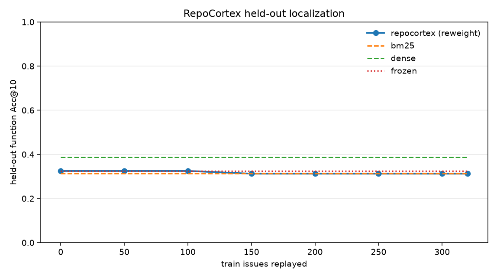
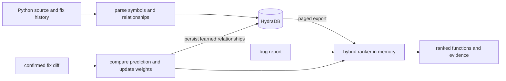
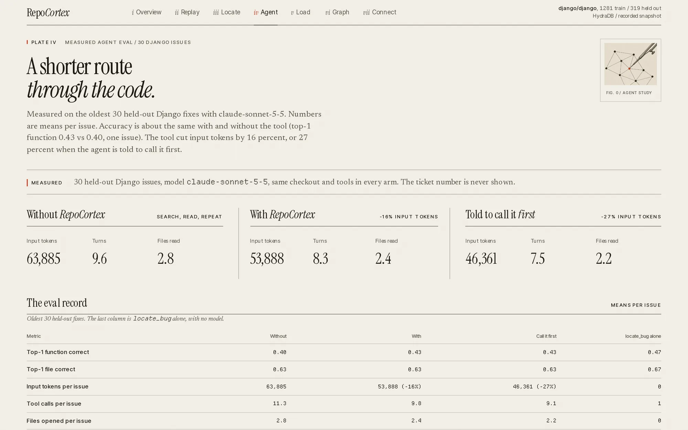
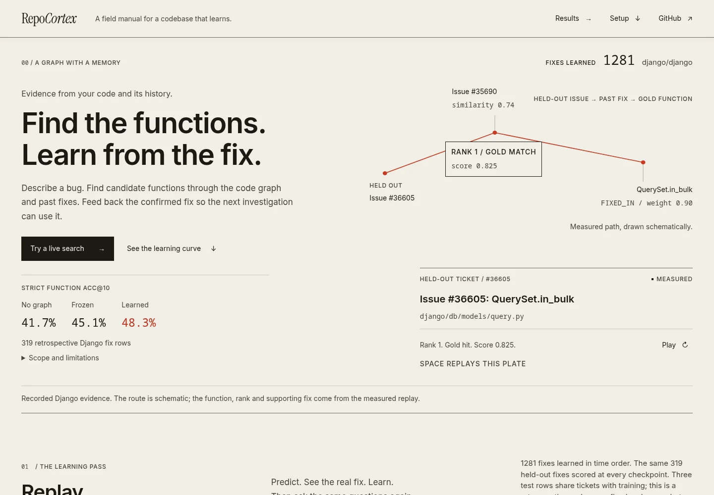
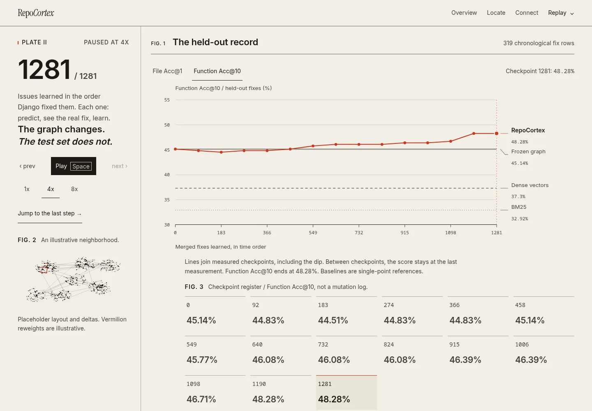
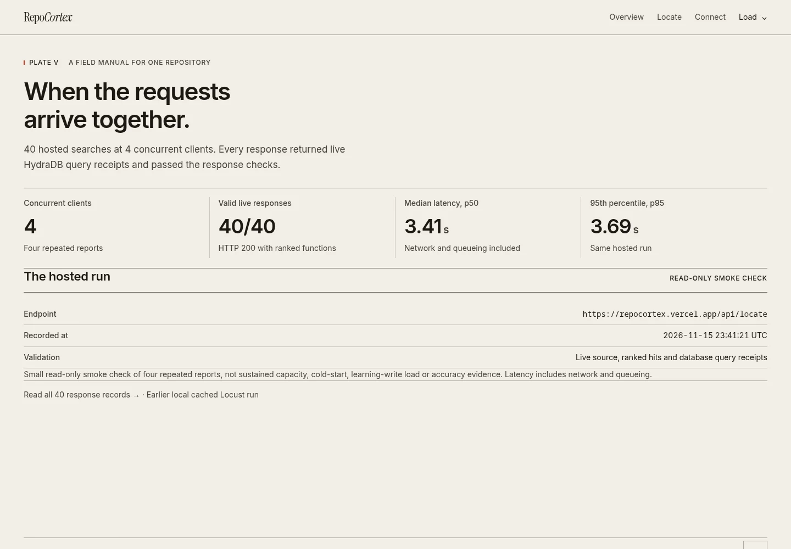
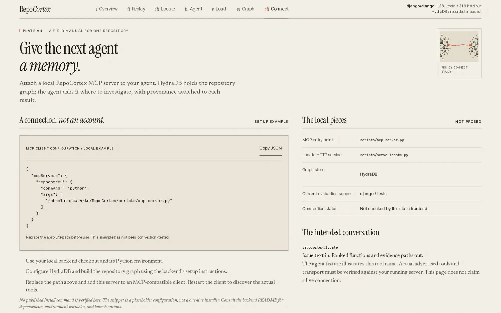

<div align="center">

# RepoCortex

**Find the functions behind a bug. Learn from the fix.**

A self-improving code graph on HydraDB · hackathon track 1

[Results](#measured-results) · [Try live search](https://repocortex.vercel.app/app/locate) · [How it works](#how-it-works) · [Reproduce](#reproduce-the-replay) · [Limitations](#limitations) · [Submission](SUBMISSION.md)


</div>

RepoCortex helps maintainers and coding agents investigate unfamiliar code. Given a bug report, it ranks the functions likely to need changing and returns the relationships behind each suggestion. Confirmed fixes become memory for later reports.

We replayed **1,281 Django fixes** in chronological order and evaluated on **319 held-out fix commits**. Strict top-10 function accuracy increased from **45.1% with learning off to 48.3% after replay**. The paired improvement is **3.1 percentage points**, with a 95% bootstrap interval of **0.9–5.6 points**.

Learning runs through historical replay or confirmed diffs submitted to `learn_from_fix`; merged pull requests are not ingested automatically.

## Start here

| You want to… | Go here |
|---|---|
| Inspect the measured learning curve | [results](#measured-results), [raw checkpoints](results/curve.json) |
| Explore the recorded demo without a database or API key | [dashboard setup](#try-the-dashboard) |
| Understand what HydraDB does | [architecture and database boundary](#how-it-works) |
| Verify search → fix → restart locally | [One-command learning check](docs/confirmed-fix.md) |
| Review and retain a confirmed fix from the terminal | [Search, preview, apply, and restart](docs/feedback-cli.md) |
| Connect a coding agent | [Local setup and first feedback](docs/local-setup.md), [MCP tools](#use-it-from-your-agent) |
| Rerun the experiment | [reproduction instructions](#reproduce-the-replay) |
| Index a Python, Go, TypeScript or JavaScript repository | [Isolated repository indexer](docs/index-repository.md) |
| Assess the customer and business case | [go-to-market](docs/GTM.md) |

**Current demo:** paste a bug report into Locate to get fresh ranked functions. The hosted service reads bounded structural edges from HydraDB during scoring and shows the executed queries; learned fix memory is loaded from the recovered runtime. Saved evaluation records remain available separately. The graph drawings are illustrative layouts.

## Measured results

All retrieval rows use the same 319 held-out fixes. Function accuracy at *k* requires **every function changed by the fix** to appear in the first *k* predictions. MRR measures the first correct function's reciprocal rank, with zero outside the top 10.

| Ranker | Function accuracy @5 | Function accuracy @10 | File accuracy @1 | MRR |
|---|---:|---:|---:|---:|
| BM25 | 27.3% | 32.9% | 34.5% | 0.324 |
| Dense vectors, MiniLM | 29.2% | 37.3% | 35.7% | 0.320 |
| Dense + BM25, no graph | 34.5% | 41.7% | 39.2% | 0.388 |
| Frozen hybrid graph | 35.4% | 45.1% | 41.1% | 0.402 |
| **Learned hybrid graph** | **37.0%** | **48.3%** | **44.5%** | **0.430** |

Source: [full metrics, intervals and configuration](results/baselines.json).

- **Learning over frozen:** +3.1 points of function accuracy @10, paired 95% interval [0.9, 5.6]. Function accuracy @5 does not show a statistically significant improvement.
- **Learned over dense:** +11.0 points of function accuracy @10, paired 95% interval [7.5, 14.4]. This comparison includes keyword blending, graph structure and learning together.
- **Learned over dense + BM25:** +6.6 points at function accuracy @10, paired 95% interval [3.8, 9.7]. The frozen graph adds 3.4 points over that same no-graph blend. [reproduced control and corrected paired intervals](results/lexical_gap.json)



The held-out curve dips early and improves after roughly 500 fixes. It is not a steady rise. The plot also includes a validation slice and an expanding training-stream comparison; neither is the held-out result.

### What contributes to learning

| Cumulative configuration | Function accuracy @10 | MRR |
|---|---:|---:|
| Learning off | 45.1% | 0.402 |
| Store fixes and reweight edges | 48.0% | 0.422 |
| Add shortcuts | 48.3% | 0.430 |
| Add gap-driven ingestion | 48.3% | 0.430 |
| Add concept merge and split | 48.3% | 0.430 |

Fix memory and reweighting account for most of the gain. Shortcuts add a small improvement; gap ingestion and merge/split do not improve the final score on this split. [ablation data](results/baselines.json)

### Does it help a coding agent?

A saved experiment compared the same 30 held-out bugs with the same model and code-search tools:

| Condition | Input tokens per issue | Top-1 function correct |
|---|---:|---:|
| Search tools alone | 63,885 | 12/30 |
| Search tools + `locate_bug` | 53,888 | 13/30 |
| Instructed to call `locate_bug` first | 46,361 | 13/30 |

The [outcome evaluation protocol](docs/agent-outcomes.md) separates regression tests, budgets, usage and failures. The [original repair pilot](results/repair_pilot.md) remains **0/2 in both arms**. A separately registered [four-run follow-up](results/repair_followup.md) passed hidden tests on **1/2 tasks in each arm**; within budget, baseline scored **0/2** and mandatory initial lookup **1/2**. One baseline repair exceeded its input budget; the other encountered a provider error. This tests frozen source assistance, not learning, and establishes no general repair or efficiency advantage. A subsequent [learned-versus-frozen repair comparison](results/learning_repair_followup.md), using the same model and tools within that study, repaired **1/2 tasks in each arm** within budget. Learned retrieval used more tokens on both tasks; it showed no repair advantage. A subsequent [correctness review](results/learning_correctness.md) fixed four learning/evidence defects; those fixes do not change the recorded repair results. A [persistence regression fix](results/zero_weight_correctness.md) also preserves explicit zero edge weights across graph reads and restarts. The published Django runtime contains no affected zero-weight edges.

A new [eight-attempt URL repair study](results/url_repair_followup.md) recorded **2/4 budget-compliant repairs in each arm**. These are four correlated, evaluator-reconstructed behavioral specifications. One learned attempt was interrupted without a final evaluation; one frozen attempt passed tests but ended in a provider timeout. All scheduled outcomes remain in the report; it does not establish a learning advantage.

The tool-available arm used **16% fewer input tokens**; the locate-first arm used **27% fewer**. A one-issue accuracy difference is too small to establish a gain. This is one model, one run per condition, and 30 tasks; input tokens include cached reads. [protocol, raw runs and caveats](results/agent_eval/README.md)

## Serving checks

The public search runs on Vercel with a persistent Railway HydraDB backend. In a small read-only check, **40/40 searches returned live results and query receipts at four concurrent clients**. End-to-end latency was **3.41s p50 / 3.69s p95**, including network and queueing. Four reports were repeated; this is a smoke check, not sustained capacity or cold-start evidence. [Raw responses and method](results/hosted_search_check_40.json)

A later varied-query check returned **120/120 valid live responses** for 120 distinct held-out reports at four concurrent clients, over **113 seconds**. Latency was **3.51s p50 / 4.07s p95**, with no retries. This short read-only exercise does not establish sustained capacity, cold-start behavior or uptime. [Protocol and all request records](results/service_reliability_120.json)

Across **all 319 held-out fix rows**, the exported graph and restored local HydraDB produced identical top-10 rankings and scores at four-decimal response precision. Benchmark-shaped and serving-shaped inputs also matched on every row. The five runtime artifact hashes stayed unchanged; no retraining or graph writes were performed. This checks the direct serving functions locally, not all 319 cases through production HTTP. A health-guard edit made during the run was not loaded by the audit process; source provenance is recorded with the result. [Full parity audit](results/serving_parity_full.json)

In a separate production check, **8/8 preselected HTTP searches** matched offline top-10 rankings and scores, with 928 query receipts preserved. This is a bounded parity sample, not a full deployed accuracy evaluation. [Production evidence](results/production_parity.json)

### Independent repository checks

Four retrospective evaluations use real linked issue reports, chronological splits and unchanged ranking settings. Click and Werkzeug were selected and their datasets frozen before scoring. Strict function accuracy@10 requires every changed function to appear in the first ten results.

| Repository | Training / held out | Text-only blend | Frozen graph | Learned graph |
|---|---:|---:|---:|---:|
| HTTPX | 51 / 33 | 13/33 (39.4%) | 14/33 (42.4%) | 15/33 (45.5%) |
| Flask | 13 / 7 | 4/7 (57.1%) | 4/7 (57.1%) | 4/7 (57.1%) |
| Click | 44 / 37 | 18/37 (48.6%) | 21/37 (56.8%) | 21/37 (56.8%) |
| Werkzeug | 26 / 16 | 9/16 (56.3%) | 8/16 (50.0%) | 9/16 (56.3%) |

**Graph structure and learning are different contributions.** Click's graph finds three more reports than the text-only blend, but learning adds none at top 10 and lowers MRR. Werkzeug's learning recovers one report lost by the frozen graph; it does not beat text-only search. HTTPX adds one report through learning, while Flask stays flat. The paired learning-gain intervals include zero; these samples do not establish reliable transfer gains.

The expanded comparison also tests flat past-fix memory without traversal and disables traversal after learning. Click's flat-memory and traversal-off arms both score 18/37; Werkzeug's both score 9/16. This helps separate the contribution of traversal from simply retaining past fixes. [All five arms, intervals, frozen datasets and reproduction](results/repository_ablations.md)

These are offline checks, not live HydraDB accuracy tests. No ticket, commit or exact normalized report overlaps occur across each split, but current source snapshots include later fixes, issue bodies may have later edits, and diff-touched functions are only a proxy for fault location. Earlier protocols remain available: [HTTPX](results/transfer_httpx.md) · [Flask](results/transfer_flask.md).

## One answer you can inspect

Held-out ticket **#36865** asks about casting in admin searches. The fix changed `ModelAdmin.get_search_results` and its nested helper `construct_search`.

Dense retrieval finds the helper at rank 2 but places the outer function at **134**. The learned ranker places the outer function at **1**, with this saved evidence:

```text
issue #26001, similarity 0.68 → FIXED_IN → ModelAdmin.get_search_results
issue #32649, similarity 0.66 → FIXED_IN → ModelAdmin.get_search_results
concept:admin               → SHORTCUT → ModelAdmin.get_search_results
```

These are recorded results, not a fresh live query. Inspect [the provenance records](results/provenance.json); with the runtime data restored, `python scripts/dense_rank.py 36865` checks the dense ranking.

## How it works



1. **Map the code.** Parse files, classes, functions and tests. Connect calls, definitions, test relationships and functions that changed together in training commits.
2. **Find entry points.** Combine dense and BM25 retrieval, then propagate scores over a weighted graph hop and retrieve similar past fixes.
3. **Learn after predicting.** Compare the prediction with the actual diff. Store fix-to-function relationships, update weights, and add supported shortcuts.
4. **Return evidence.** Attach stored fix links and shortcut receipts to candidate functions for inspection.

### Where HydraDB participates

HydraDB 0.4.0 stores the graph and learned relationships. Ingestion and replay use batched writes; evaluation normally reloads the graph through paged, count-checked reads. The initial graph has **46,443 nodes and 138,150 edges**. The saved learned export has **48,663 nodes and 141,435 edges**. [initial counts](results/graph_stats.json) · [learned export](results/graph.json)

**The serving boundary matters:** the HTTP and MCP locate tools read structural edges from HydraDB for each live request and use those edges in ranking. Responses include the executed Cypher, parameters, and returned row counts. Embeddings and learned fix memory load from the recovered runtime files. Without a database connection, the service labels its answers as cached replay; the recorded evaluation uses the offline scorer. See [the recovery guide](docs/recovery.md).

Relationship types include `CALLS`, `CO_CHANGED`, `TESTED_BY`, `DEFINES`, `FIXED_IN` and `SHORTCUT`. Their exact spelling is retained in code and queries.

## Try the dashboard

Requires Node.js 20.9+ and npm. No database, runtime dataset or model API key is needed to inspect the saved results.

```sh
git clone https://github.com/codebanditssss/repocortex.git
cd repocortex/web
npm ci
npm run dev
```

Open [localhost:3000](http://localhost:3000), then [/app](http://localhost:3000/app).

Start with **replay** for the curve, **locate** for saved evidence, and **agent** for the token comparison. Graph layouts and edge-delta animations are fixtures; measured scores come from committed result files. See the [web guide](web/README.md) for routes and controls.

### Dashboard screenshots

Screenshots captured from the site and current local build on 16 November 2026, with the current typography and navigation. Benchmark panels show recorded results; Locate includes live search and saved evidence.

| Overview | Locate |
|---|---|
|  |  |
| **Agent comparison** | **Graph explorer** |
|  |  |

<details>
<summary>More screens and replay animation</summary>

| Landing | Replay |
|---|---|
|  |  |
| **Load test** | **Connect** |
|  |  |


</details>

## Use it from your agent

For a complete sequence, follow [local setup and first feedback](docs/local-setup.md). Start from the repository root with Python 3.11+:

```sh
python3 -m venv .venv
.venv/bin/python -m pip install -e .
.venv/bin/python scripts/preflight.py
```

The preflight reports missing packages or runtime files without loading a model or writing to the database. A fresh clone needs these four runtime files:

```text
data/corpus.json
data/embeddings.npz
data/learned_state.json
data/learned_state.npz
```

Download the published matching runtime into a fresh checkout (Python standard library only):

```sh
python3 scripts/download_runtime.py
.venv/bin/python scripts/preflight.py
```

The command pins the release checksum, verifies every file, and refuses existing runtime files. It does not retrain or write to HydraDB. See [recovery and database restore](docs/recovery.md). The graph export alone does not include source text, embeddings or ordered fix memory.

After recovering matching runtime files and restoring HydraDB, check the connection and launch the read-only HTTP MCP server:

```sh
.venv/bin/python scripts/preflight.py --database
.venv/bin/python scripts/mcp_server.py --http
```

Configure an MCP client that supports streamable HTTP to use `http://127.0.0.1:8765/mcp`. For stdio, launch `.venv/bin/python scripts/mcp_server.py` from the repository root; use absolute paths in clients launched elsewhere.

| Tool | Purpose |
|---|---|
| `locate_bug(report, k)` | Rank candidate functions with file, line, score and evidence |
| `graph_status()` | Check the live database connection or cached replay mode |
| `learn_from_fix(report, diff)` | Predict before learning a confirmed fix in a configured durable namespace; local stdio only |

Retrieval uses local embeddings and makes no generation-model API calls. Model-backed agent evaluations are separate and require provider credentials.

For a newly indexed repository, you can inspect its first ranked result before
provisioning HydraDB:

```sh
.venv/bin/python -m scripts.feedback_cli search \
  --offline \
  --runtime /absolute/path/to/myproject-runtime \
  --report report.txt
```

This is a read-only cached preview. It cannot load or retain feedback and is
not evidence of live HydraDB traversal. Restore the matching runtime into a
dedicated HydraDB database, then use the normal search/preview/apply workflow
for live query receipts and durable learning. See the
[isolated repository guide](docs/index-repository.md).

## Durable local feedback

For a trusted local MCP client, set `REPOCORTEX_FEEDBACK_NAMESPACE` to a unique project-and-snapshot name before starting the stdio server. Configure HydraDB through the existing environment variables. The server must connect successfully before it accepts durable feedback. Without a namespace, MCP rejects feedback instead of overwriting the shared runtime files; search remains available.

```sh
REPOCORTEX_FEEDBACK_NAMESPACE=myrepo-snapshot-v1 .venv/bin/python scripts/mcp_server.py
```

Confirmed `learn_from_fix` calls write a namespaced feedback journal to HydraDB before updating scoring. On a fresh process, the server validates the base snapshot fingerprint and replays those records into scoring memory and learned edges. Exact repeats are idempotent. Keep the base runtime files unchanged and use **one writer per namespace**. Back up the database and runtime files together. This is a durable journal with reconstructed scoring state, not a claim that all embeddings or learned edge weights are served directly from HydraDB. Direct local snapshots preserve materialized learning state but not pending operator counters; use a feedback namespace and journal replay to preserve those counters across restarts.

The public website remains read-only. MCP HTTP transport also refuses feedback; use trusted local stdio for writes. Reports are bounded to 12,000 characters and diffs to 256,000 UTF-8 bytes. A failed post-commit application blocks reads and writes until restart/replay.

A real Django check used ticket **#37442** and its exact upstream fix diff: the confirmed `Deserializer.__init__` moved from rank 2 to rank 1 after feedback. A fresh Python process restored the same top-10 ranking and provenance, and repeated feedback was skipped. All five runtime hashes and benchmark node counts stayed unchanged; the temporary namespace was removed. This deliberately learns one test example to verify durability, **not** to measure held-out accuracy or generalization. It tests process restart, not database-server restart. [Raw verification](results/real_feedback_persistence.json)

Feedback maps added lines onto the indexed new-file snapshot and excludes unchanged diff context. Deletion-only changes are mapped conservatively; a deleted function requires an old snapshot and is not guessed. Journals written with the previous whole-hunk mapper are rejected by the updated fingerprint; use a new namespace rather than silently replaying different labels.

A two-function synthetic fixture changed its first-ranked function after feedback and retained that ranking in a fresh subprocess reading real HydraDB. Namespace cleanup left the benchmark graph untouched. This is persistence evidence, not an accuracy result. [Verification](results/persistent_feedback.json)

## Reproduce the replay

Requires Python 3.11+, Docker Compose, git, and network access for source, ticket text, the container image and the embedding model. Use a **fresh dedicated database** for an experiment. Replay updates graph state and writes `results/`; keep a separate checkout if preserving the committed measurements.

```sh
python3 -m venv .venv
. .venv/bin/activate
pip install -e .

# local development only; the token matches the default client settings
mkdir -p data/hydradb/store data/hydradb/cache
printf '%s\n' 'local-development-token-32-bytes' > data/hydradb/auth-token
export HYDRADB_UID="$(id -u)" HYDRADB_GID="$(id -g)"
docker compose up -d hydradb
```

Wait for [the readiness endpoint](http://127.0.0.1:9090/readyz) to report ready. Use `.env.example` as the configuration reference; keep the client password and database token consistent if changing them.

```sh
git clone --filter=blob:none --sparse https://github.com/django/django.git data/django
git -C data/django sparse-checkout set django tests
git -C data/django checkout f24f38c6b282
python scripts/mine_django.py --limit 1600
python scripts/build_graph.py
python scripts/run_eval.py --replay
```

The first embedding run downloads `sentence-transformers/all-MiniLM-L6-v2`. Exact published reproduction also needs the original dataset and ticket cache: re-fetching mutable ticket text can change inputs. Report regenerated measurements as a new run.

### Checks and load testing

```sh
python -m unittest discover -s tests
cd web
npm test
npm run lint
npm run build
```

For the HTTP load-test setup, install `locust`, run `python scripts/serve_locate.py 8765` from the repository root, then in a second terminal:

```sh
locust -f scripts/locustfile.py --headless -u 8 -r 4 -t 20s --host http://127.0.0.1:8765
```

The saved run recorded 1,251 requests, zero failures and 44 ms p95 with eight users over 20 seconds. It used the smaller phase-2 graph and cached serving; it is **not full-graph or database-query latency**. [load-test record](results/loadtest.json)

## Limitations

- **One repository and one source snapshot.** The evaluation uses Django at `f24f38c6b282`, including `django/` and `tests/`. The code snapshot already contains fixes; it is not a checkout-before-each-fix replay.
- **A filtered task.** Fix subjects match `Fixed #NNNN`; ticket text comes from Trac. Diff hunks map to functions. Test-only fixes and fixes touching more than eight functions are excluded.
- **Chronological split.** 1,281 fixes train the graph; the newest 319 are held out. Reported intervals use 1,000 bootstrap resamples. Stronger memory settings were tested on a training-side validation slice and rejected. [tuning log](results/tuning.json)
- **Split audit.** Three test rows refer to two tickets also present in training. Excluding those rows leaves 316 fixes: no-graph 42.1%, frozen 45.6%, learned 48.7%. Paired intervals resample fix rows, not independent ticket clusters. [audit and reproduction](docs/evaluation-audit.md)
- **Saved evidence versus live behavior.** Evaluation uses the offline graph scorer. Live requests use bounded structural reads from HydraDB plus cached learned memory, so these measurements are not live-service latency or accuracy claims. Runtime files are required for serving.
- **Limited agent and load studies.** Neither establishes production-scale reliability, generality across models, or guaranteed cost savings.

## Who this is for

Maintainers and engineering teams using coding agents on large Python repositories. The proposed value is a reusable starting point for investigating bugs: candidate functions, reasons to inspect them, and memory of confirmed fixes. The agent study gives an early indication of reduced search effort; customer demand and willingness to pay remain to be validated.

The graph and local embedding model can run on the team's infrastructure. Code sent to an external coding agent remains subject to that agent's data handling. [customer, distribution and pricing hypotheses](docs/GTM.md)

## Project map and attribution

| Path | Contents |
|---|---|
| `repocortex/graph/`, `repocortex/hydradb/` | Graph construction, ingestion and database adapters |
| `repocortex/retrieve/`, `repocortex/learn/` | Retrieval, fix memory and learning operators |
| `repocortex/eval/`, `scripts/` | Metrics, bootstrap intervals, replay and serving commands |
| `results/` | Saved measurements, provenance and experiment records |
| `web/` | Landing page and recorded-results dashboard |

Built for the HydraDB hackathon, November 14–16, 2026, track 1. Graph engine: [HydraDB](https://github.com/hydra-db/hydradb). Code and fix history: [Django](https://github.com/django/django) and its Trac tracker. Embeddings: [all-MiniLM-l6-v2](https://huggingface.co/sentence-transformers/all-MiniLM-L6-v2). Dependencies and datasets retain their respective licenses.

## License

RepoCortex's original code is available under the [MIT License](LICENSE). Third-party dependencies, model weights, repository source excerpts and issue datasets retain their respective licenses and attribution; this license does not relicense them.
