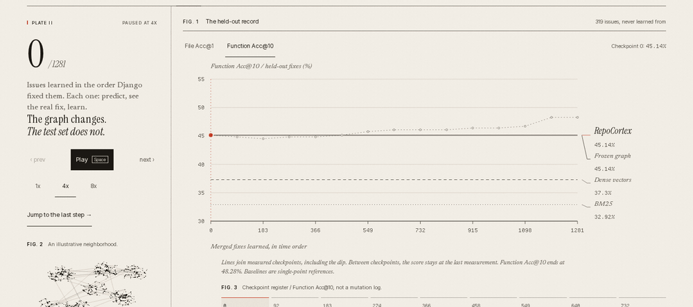
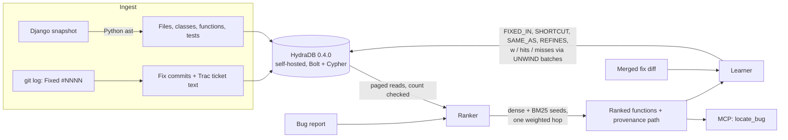
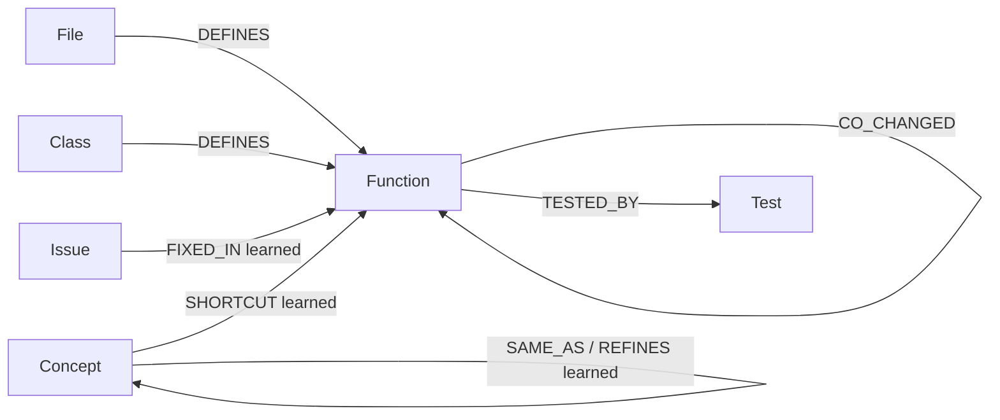
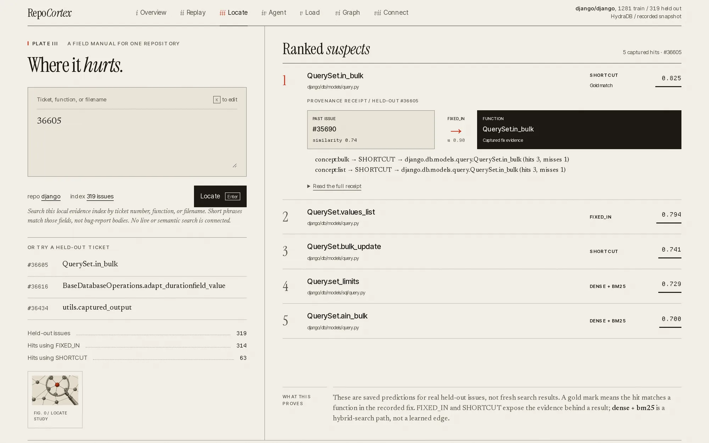
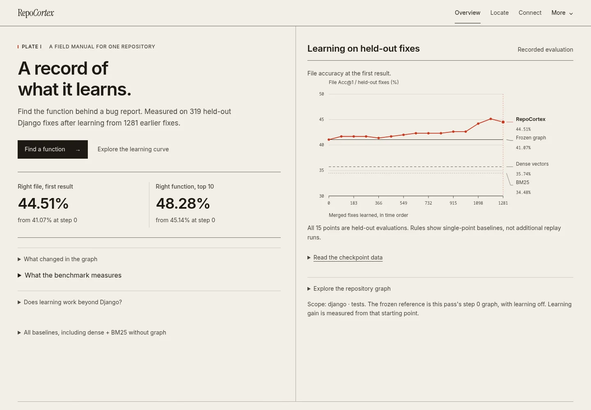
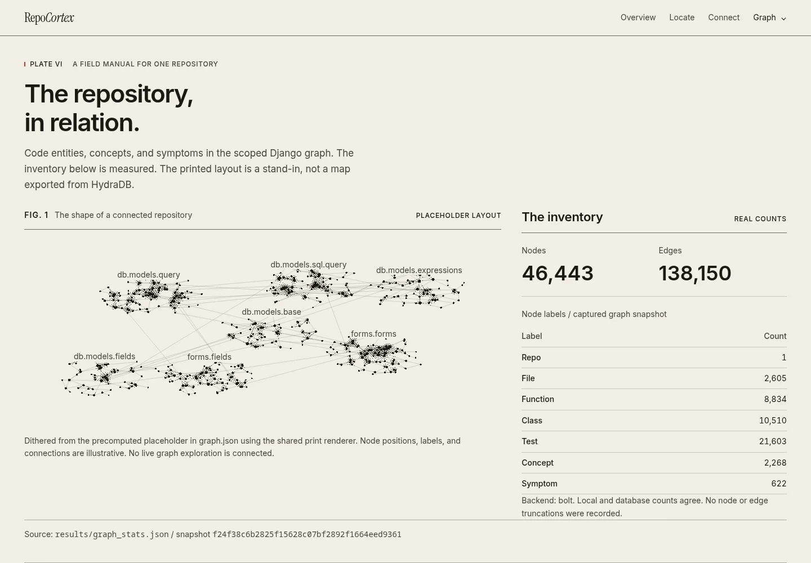

<div align="center">

# RepoCortex

**A code graph in HydraDB that gets better at finding bugs every time a fix is merged.**

Built for the HydraDB Hackathon, Track 1: self-improving graph.


[Results](#results-at-a-glance) | [Evidence](#evidence-up-front) | [Why a graph](#why-a-graph-and-not-a-vector-store) | [How it works](#how-it-works) | [MCP quickstart](#use-it-from-your-agent) | [Reproduce](#reproduce) | [GTM](docs/GTM.md) | [Submission](SUBMISSION.md)

</div>

You paste a bug report. RepoCortex returns the functions most likely to need changing, each with the graph path that got it there. When the real fix lands, it checks its own guess against the diff and rewires the graph. We replayed 1281 real Django fixes in the order they were merged and scored it on the 319 newest bugs it never saw.

## Results at a glance

Held-out set: the newest 319 Django fixes by commit time. Brackets are 95% bootstrap intervals (1000 resamples).

| ranker | fn Acc@5 | fn Acc@10 | file Acc@1 | file Acc@5 | MRR |
|---|---:|---:|---:|---:|---:|
| BM25 | 0.273 [0.223, 0.323] | 0.329 [0.276, 0.382] | 0.345 [0.298, 0.398] | 0.618 [0.561, 0.671] | 0.324 [0.282, 0.366] |
| dense vectors (MiniLM) | 0.292 [0.238, 0.342] | 0.373 [0.317, 0.426] | 0.357 [0.307, 0.411] | 0.696 [0.639, 0.746] | 0.320 [0.279, 0.360] |
| RepoCortex, step 0 (frozen graph) | 0.354 [0.298, 0.404] | 0.451 [0.395, 0.505] | 0.411 [0.360, 0.461] | 0.734 [0.683, 0.781] | 0.402 [0.358, 0.443] |
| **RepoCortex, after 1281 fixes** | **0.370 [0.313, 0.423]** | **0.483 [0.423, 0.533]** | **0.445 [0.392, 0.502]** | **0.762 [0.712, 0.809]** | **0.430 [0.385, 0.475]** |

The same held-out set, scored at every learning checkpoint of the replay:

| step | 0 | 92 | 183 | 274 | 366 | 458 | 549 | 640 | 732 | 824 | 915 | 1006 | 1098 | 1190 | 1281 |
|---|---:|---:|---:|---:|---:|---:|---:|---:|---:|---:|---:|---:|---:|---:|---:|
| fn Acc@10 | 0.451 | 0.448 | 0.445 | 0.448 | 0.448 | 0.451 | 0.458 | 0.461 | 0.461 | 0.461 | 0.464 | 0.464 | 0.467 | 0.483 | 0.483 |
| MRR | 0.402 | 0.405 | 0.410 | 0.409 | 0.406 | 0.403 | 0.410 | 0.408 | 0.408 | 0.412 | 0.414 | 0.415 | 0.412 | 0.424 | 0.430 |

These held-out numbers did not move in the latest pass. A search for a stronger memory signal ran first on the training side only, every change lost, and the holdout was scored once with the same settings.

Two curves that rise earlier. **Neither is the holdout**, and they are labeled that way everywhere:

| curve (not the holdout) | start | end | change |
|---|---:|---:|---:|
| Validation slice, newest 256 training issues, fn Acc@10 | 0.414 | 0.449 (peak 0.453 at step 879) | +0.035 |
| Validation slice, MRR | 0.380 | 0.414 | +0.034 |
| Expanding window, 1281 training issues, fn Acc@10: learning vs frozen | frozen 0.439 | learning 0.472 | +3.4 points |
| Expanding window, MRR: learning vs frozen | frozen 0.391 | learning 0.424 | +3.3 points |

Coding agent (30 held-out bugs, Claude Sonnet 5.5): **16% fewer input tokens** with the RepoCortex MCP tool available, **27% fewer** when told to call it first, same accuracy.

## Evidence up front

| claim | number | where it comes from |
|---|---|---|
| Beats a plain vector store | fn Acc@10 **0.483** vs dense **0.373** vs BM25 **0.329**. Paired gap over dense: **+11.0 points** [7.5, 14.4] | [`results/baselines.json`](results/baselines.json) |
| Learning moves the held-out score | fn Acc@10 0.451 at step 0 to 0.483 after 1281 fixes. Paired lift **+3.1 points** [0.9, 5.6], MRR 0.402 to 0.430 | [`results/curve.json`](results/curve.json), [`results/curve.png`](results/curve.png) |
| The nearer future rises earlier | Validation fn Acc@10 0.414 to 0.449 (peak 0.453), MRR 0.380 to 0.414. Not the holdout | [`results/curve.json`](results/curve.json), [`results/tuning.json`](results/tuning.json) |
| Memory holds up as bugs get harder | Expanding window vs a frozen replay: **+3.4 points** fn Acc@10 and **+3.3 points** MRR after 1281 issues. Not the holdout | [`results/curve.json`](results/curve.json) |
| Agents do less work with it | **16%** fewer input tokens, **27%** when told to call it first, 22% lower cost | [`results/agent_eval/`](results/agent_eval/README.md) |
| The tool alone is a strong first guess | `locate_bug` top-1 function **0.47** vs the Claude agent's **0.40** (14 vs 12 of 30), under a second, no model call | [`results/agent_eval/tool_only.json`](results/agent_eval/tool_only.json) |
| It is fast enough to sit in an agent loop | p95 **44 ms**, p50 21 ms, 63 req/s, **0 failures** over 1,251 requests | [`results/loadtest.json`](results/loadtest.json) |
| Every answer is explainable | 314 held-out hits carry a `FIXED_IN` receipt, 63 carry a learned `SHORTCUT` | [`results/provenance.json`](results/provenance.json) |

<p align="center"></p>

A 2 minute narrated walkthrough is linked from [SUBMISSION.md](SUBMISSION.md). The script is in [`docs/demo-script.md`](docs/demo-script.md).

## Why a graph and not a vector store

A bug report and the function that fixes it often share almost no words. "Casting on `__exact` searches over non-text fields in admin misses indexes" does not say `get_search_results`. A vector store can only compare the report to each function's text, one at a time. Bug location depends on things that are not in that text:

- **Past fixes are memory.** Similar tickets were fixed in the same places before. RepoCortex keeps every training fix as a `FIXED_IN` edge from the issue to the functions its diff touched.
- **Co-change.** Functions that keep changing in the same commits are linked by `CO_CHANGED`, built from training commits only.
- **Call paths.** The symptom shows up in one function and the bug lives in its caller or callee. `CALLS` edges carry the score across.
- **Test coverage.** 21,603 test functions with `TESTED_BY` edges tie failing behavior back to the code it covers.
- **Learned shortcuts.** When the same detour keeps reaching the right function, the graph writes a direct `SHORTCUT` edge and tracks its hits and misses.

A real held-out example, ticket #36865, "Casting on __exact searches over non-text fields in admin misses indexes". The fix touched `ModelAdmin.get_search_results` and its nested helper `construct_search`. Plain MiniLM dense search over the issue text finds the helper at #2 but ranks `get_search_results` itself **#134** of 8,834. RepoCortex ranks it **#1**, and says why:

```text
held-out issue #36865
  issue #26001 (similarity 0.68) -FIXED_IN-> ModelAdmin.get_search_results   (w 1.00)
  issue #32649 (similarity 0.66) -FIXED_IN-> ModelAdmin.get_search_results   (w 0.96)
  concept:admin -SHORTCUT-> ModelAdmin.get_search_results                    (hits 3, misses 0)
rank 1, gold
```

Another one: ticket #36112, "Subclasses of BaseDatabaseOperations should fall back to super().last_executed_query() instead of returning None". Dense ranks the two gold functions #56 and #743. RepoCortex puts the Oracle `last_executed_query` at #1 through one memory edge: `issue #36111 (similarity 0.60) -FIXED_IN-> oracle DatabaseOperations.last_executed_query`. The ticket right before it was fixed in the same place.

Paths are copied from [`results/provenance.json`](results/provenance.json). Dense ranks come from [`scripts/dense_rank.py`](scripts/dense_rank.py) (`python scripts/dense_rank.py 36865 36112`).

## How it works



**Graph schema.** 46,443 nodes and 138,150 edges in the scoped Django graph: 2,605 files, 10,510 classes, 8,834 functions, 21,603 tests, 2,268 concepts, 622 symptoms.



Every edge carries `w`, `hits`, and `misses`. Structural edges start at `w = 1.0`.

**The loop.** For each training fix, oldest first:

1. Predict: seed with dense and BM25 hits, take one weighted hop over `CALLS`, `CO_CHANGED`, `TESTED_BY`, `DEFINES`, mix in past fixes of similar issues.
2. Compare the top 10 with the functions the real diff touched.
3. Run the four operators and write the changed edges back to HydraDB.

**How HydraDB is used.** HydraDB is the system of record. The builder batch-loads the graph with `UNWIND ... MERGE` on our own ids. Reads are paged and checked against `count(*)`, so a silent truncation would show up in [`results/graph_stats.json`](results/graph_stats.json) (there was none). Learned edges and weights go back in batches:

```cypher
UNWIND $rows AS row
MATCH (a {id: row.src})-[r:SHORTCUT]->(b {id: row.dst})
SET r.w = row.w, r.hits = row.hits, r.misses = row.misses
```

Path expansion for provenance uses bounded variable-length Cypher, one relationship type per pattern, as the OSS engine requires:

```cypher
MATCH (s {id: $id})-[:CALLS*1..2]->(f:Function)
WHERE f.id <> $id RETURN f.uid AS uid LIMIT 80
```

Hosted Cypher has no APOC or GDS, so the scoring walk runs in process over the edge table read from HydraDB. The same client also speaks the hosted `POST /byog/query` API (`HYDRADB_API_KEY`), so moving to HydraDB Cloud is a config change.

## The four learning operators

| operator | what it does | times it fired |
|---|---|---:|
| Edge reweighting | Store the fix as `FIXED_IN`. Credit edges on paths that reached a gold function, debit edges that promoted a wrong top-10 hit. Weights decay back toward 1. | 3,408 |
| Path compression | After 3 supporting fixes at precision 0.4 or better, write a direct `SHORTCUT` edge. | 535 |
| Gap-driven ingestion | When gold sits outside the frontier, link a same-file neighbor and a matching test. | 1,667 |
| Concept merge and split | `SAME_AS` and `REFINES` between concepts that keep pointing at the same or different code. | 33 |

Ablation, final held-out scores after 1281 fixes. Each line adds one operator:

| line | fn Acc@10 | file Acc@1 | MRR |
|---|---:|---:|---:|
| learning off | 0.451 | 0.411 | 0.402 |
| reweight | 0.480 | 0.436 | 0.422 |
| +shortcuts | 0.483 | 0.445 | 0.430 |
| +gap | 0.483 | 0.445 | 0.430 |
| full | 0.483 | 0.445 | 0.430 |

Storing fixes and reweighting does almost all of the lift. Shortcuts add a little MRR. Gap ingestion and merge/split fire but do not move the final number on this split. We kept them in the ablation instead of hiding that.

## Where the curve rises


The held-out line sits on the frozen score until about step 500, then gains about 3 points. That is real, and it is late.

**Why the curve starts late.** Early on, a held-out bug often looks like an older ticket and still names a different function. By step 100, 42.6% of the holdout already has a past fix with cosine similarity of at least 0.55, but that nearest neighbor shares a gold function only 3.5% of the time. By the end of training the nearest fix is right 18.5% of the time, and some neighbor above 0.55 is right 34.5% of the time. Copying the neighbor's functions early mostly copies the wrong function, so a stronger memory weight hurts before it helps. Source: [`results/diagnosis.json`](results/diagnosis.json). It was not used to pick settings.

**The settings search.** It replayed the older 1025 training issues and scored the newest 256, never the holdout. The rule was fixed first: maximize `0.65 * final validation MRR + 0.35 * midpoint validation MRR`, and keep a change only if it beats the current score by more than 0.01 without losing more than 0.02 validation Acc@10. The grid covered memory weight, similarity threshold, neighbor count, sum vs max, file and module priors, recency, credit decay, earlier shortcuts, and a rerank-only memory gate. The published settings scored 0.407, the best challenger 0.413. Nothing cleared the bar. Log: [`results/tuning.json`](results/tuning.json).

**Validation slice, the newest 256 training issues. Not the holdout.**

| fit issues | 0 | 146 | 293 | 439 | 586 | 732 | 879 | 1025 |
|---|---:|---:|---:|---:|---:|---:|---:|---:|
| fn Acc@10 | 0.414 | 0.418 | 0.418 | 0.426 | 0.434 | 0.445 | 0.453 | 0.449 |
| MRR | 0.380 | 0.380 | 0.389 | 0.389 | 0.394 | 0.399 | 0.407 | 0.414 |

**Expanding window on the training stream. Not the holdout.** Each training issue is scored before the operators see it, and the same issues are scored with learning off. Both lines climb over the first few hundred issues, so that early climb is not learning by itself. After that, learning stays up and the frozen line falls.

| issues seen | learning Acc@10 | frozen Acc@10 | learning MRR | frozen MRR |
|---:|---:|---:|---:|---:|
| 100 | 0.460 | 0.450 | 0.383 | 0.376 |
| 400 | 0.500 | 0.482 | 0.434 | 0.412 |
| 1281 | 0.472 | 0.439 | 0.424 | 0.391 |

The rolling window of 100 says the same thing: learning scores 0.460 on the first 100 and 0.460 on the last 100, while the frozen ranker falls from 0.450 to 0.410. Later issues are harder, and memory is what holds the rate.

**Seen file vs unseen file.** On held-out issues whose file a training fix already touched, fn Acc@10 goes from 0.359 at step 92 (145 issues) to 0.456 at step 1281 (296 issues). Membership grows as files are observed, so this is not one fixed cohort. The unseen-file group shrinks from 174 to 23 issues, and the ones left are mostly files the frozen ranker already hits. Module-level splits say little: 315 of 319 held-out issues are in a seen module by step 92, and only 3 are still unseen at the end.

## Provenance

Every result from `locate_bug` comes with its path, so an agent or a reviewer can check the reason before opening a file.



```text
held-out issue #36605  "Support chaining QuerySet.in_bulk() after .values() or .values_list()"
  issue #35690 (similarity 0.74) -FIXED_IN-> QuerySet.in_bulk   (w 0.90)
  concept:bulk -SHORTCUT-> QuerySet.in_bulk                      (hits 3, misses 1)
  concept:list -SHORTCUT-> QuerySet.in_bulk                      (hits 3, misses 1)
rank 1, score 0.825, gold
```

## Use it from your agent

RepoCortex ships as an MCP server with two tools:

- `locate_bug(report, k)` returns ranked functions with file, line, score, and the provenance path.
- `learn_from_fix(report, diff)` maps a unified diff to functions, predicts first, then stores the fix. The next `locate_bug` sees the update.

Cursor (`.cursor/mcp.json`) or Claude Code (`.mcp.json`):

```json
{
  "mcpServers": {
    "repocortex": {
      "command": ".venv/bin/python",
      "args": ["scripts/mcp_server.py"]
    }
  }
}
```

Or run `python scripts/mcp_server.py --http` and point the client at `{"url": "http://127.0.0.1:8765/mcp"}`. The server reads `data/corpus.json`, `data/embeddings.npz`, and `data/learned_state.npz`, and makes no LLM calls.

## Agent eval

A tool-using Claude agent (`claude-sonnet-5-5`) had to name the functions each of the oldest 30 held-out fixes touched. Every arm had the same Django checkout and the same `search_code`, `read_file`, and `list_dir` tools. The ticket number was never shown.

| | no RepoCortex | with `locate_bug` | told to call it first | `locate_bug` alone |
|---|---:|---:|---:|---:|
| top-1 function correct | 0.40 | 0.43 | 0.43 | 0.47 |
| input tokens per issue | 63,885 | 53,888 (-16%) | 46,361 (-27%) | 0 |
| tool calls per issue | 11.3 | 9.8 | 9.1 | 1 |
| files opened per issue | 2.8 | 2.4 | 2.2 | 0 |
| cost per issue | $0.063 | $0.054 (-15%) | $0.049 (-22%) | $0 |

Accuracy is about the same with and without the tool. The difference is one bug out of 30, which is noise. The agent just does less digging: 13% fewer tool calls and 16% fewer input tokens. Left alone, it called `locate_bug` on only 13 of 30 bugs, which is why "call it first" saves more. Full table and caveats in [`results/agent_eval/README.md`](results/agent_eval/README.md). The whole eval cost $4.99.

## Dashboard

The web app in [`web/`](web/) reads copies of the measured `results/` files from `web/public/data/`. Run it with `cd web && npm install && npm run dev`.

| | |
|---|---|
| <br>Landing | <br>Overview |
| <br>Replay | <br>Locate |
| <br>Agent | <br>Load |
| <br>Graph | <br>Connect |

The graph drawings on Replay and Graph are a precomputed stand-in layout, and the screens say so. The node and edge counts are real.

## Load test

Locust, 8 concurrent users for 20 seconds against `POST /locate`: 1,251 requests, 0 failures, p50 21 ms, p95 44 ms, p99 56 ms, 63 requests per second. This ran on the smaller phase 2 graph and has not been rerun on the full one.

## Methodology and honest caveats

- **Data.** Django commits whose subject matches `Fixed #NNNN`, ticket text from Trac, snapshot `f24f38c6b282`, scope `django/` and `tests/`. Diff hunks map to the enclosing function. Fixes touching more than 8 functions, or only tests, are dropped. Split is by commit time: 1281 train, 319 held out.
- **Metrics.** fn Acc@k is strict: every gold function must be in the top k. File Acc@1 is the top file. MRR is the reciprocal rank of the first gold function, 0 outside the top 10.
- **Most of the gap over dense is there at step 0.** The frozen graph already scores 0.451. Learning adds +3.1 points of fn Acc@10 [0.9, 5.6] and +0.026 MRR. fn Acc@5 lift is not significant (its interval starts at -0.009).
- **The step 0 ranker blends BM25 into dense.** We report dense and BM25 alone, but not dense + BM25 without the graph hop.
- **The held-out curve is late.** It sits on the frozen score until about 500 fixes, then climbs about 3 points. Stronger memory settings lost on the validation slice, so the shape was not forced. The validation and expanding-window curves rise earlier, and neither is the holdout. See [Where the curve rises](#where-the-curve-rises).
- **One repository.** Everything here is Django. A second repo was not replayed.
- **The agent eval is small.** 30 bugs, one model, one run each.
- **Hyperparameters** (BM25 blend, graph mix) were picked on the last 40 training issues of a smaller split, never on the holdout.

## Reproduce

```bash
python3 -m venv .venv && source .venv/bin/activate && pip install -e .

# self-hosted HydraDB 0.4.0
mkdir -p data/hydradb/store data/hydradb/cache
printf '%s\n' 'local-development-token-32-bytes' > data/hydradb/auth-token
docker compose up -d hydradb

# data, graph, replay
git clone --filter=blob:none --sparse https://github.com/django/django.git data/django
git -C data/django sparse-checkout set django tests
python scripts/mine_django.py --limit 1600
python scripts/build_graph.py --reset
python scripts/run_eval.py --replay          # writes results/*.json and curve.png

# serve, load, agent eval
python scripts/mcp_server.py               # stdio MCP for Cursor / Claude Code
python scripts/serve_locate.py 8765        # plain HTTP front used by the load test
locust -f scripts/locustfile.py --headless -u 8 -r 4 -t 20s --host http://127.0.0.1:8765
python scripts/agent_bench.py report

python -m unittest discover -s tests
```

The password in `.env.example` is the public local-development token from the HydraDB docs, not a cloud key. Wait for `http://127.0.0.1:9090/readyz` before building. The dense baseline downloads `sentence-transformers/all-MiniLM-L6-v2` on first use.

<details>
<summary>Repo layout</summary>

- `repocortex/graph` builder and HydraDB ingest
- `repocortex/hydradb` Bolt (OSS) and hosted `/byog/query` adapters
- `repocortex/retrieve` BM25, dense, frozen and hybrid rankers
- `repocortex/learn` reweight, compress, gap, merge, replay
- `repocortex/eval` metrics, bootstrap, plots
- `scripts/` mine, build, eval, MCP server, load and agent benches
- `results/` every number in this README
- `web/` landing page and dashboard

</details>

## Who pays for this

Teams that already run coding agents on a large, old codebase. Their agents spend a large share of every task finding where to edit, and that search starts from zero every time. RepoCortex turns the fix history they already have into a ranked, explainable starting point, and it improves on its own as they merge. It plugs in as an MCP server, so there is nothing to change in Cursor, Claude Code, or a custom agent. It runs on self-hosted HydraDB, so private code never leaves their machines.

More in [docs/GTM.md](docs/GTM.md).

## Roadmap

Done this weekend:

- [x] Django replay in time order with a held-out curve and confidence intervals
- [x] Four learning operators with ablations
- [x] MCP `locate_bug` and `learn_from_fix`
- [x] Agent eval with and without the tool
- [x] Load test and the dashboard
- [x] Diagnosis of the late held-out curve, with a validation curve and an expanding-window gap

Next:

- [ ] Ingest on merge from a GitHub webhook instead of a replay
- [ ] More repos and languages (tree-sitter beyond the Python `ast` path)
- [ ] Rerun the load test on the full graph and at higher concurrency
- [ ] A dense + BM25 baseline without the graph hop, and a second agent model

## Acknowledgements

Built on [HydraDB](https://github.com/hydra-db/hydradb) 0.4.0 for the HydraDB Hackathon, November 14 to 16, 2026. Data from the [Django](https://github.com/django/django) project and its Trac tracker.
